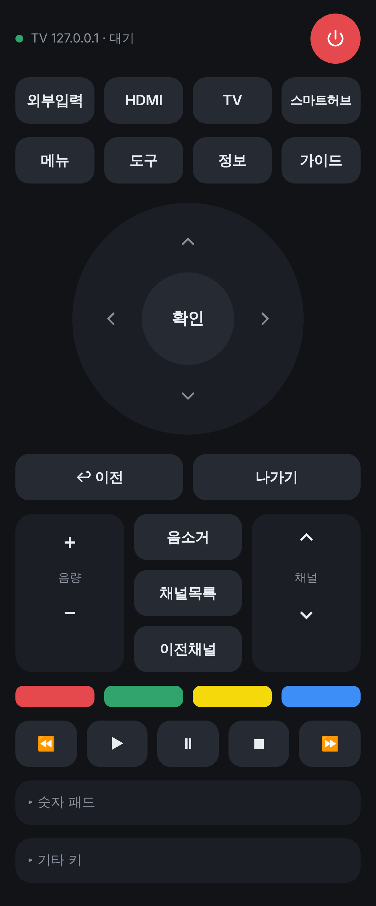

# 삼성 UN32ES6400F TV 리모컨

삼성 **UN32ES6400F (2012년 ES 시리즈)** 를 휴대폰 브라우저로 조작하는 리모컨 앱입니다.
Python 3.8+ 만 있으면 됩니다 (외부 라이브러리 없음).



## 왜 서버가 필요한가요?

2012년형(ES 시리즈) 삼성 TV는 최신 모델의 WebSocket 방식(8001/8002 포트)이 아니라
**TCP 55000 포트의 레거시 리모컨 프로토콜**을 씁니다. 브라우저는 TCP 직접 연결을 할 수 없어서:

```
휴대폰 브라우저 ──HTTP──▶ remote.py (PC / 라즈베리파이) ──TCP 55000──▶ TV
```

## 사용법

1. TV를 공유기에 연결(유선 또는 Wi-Fi)하고 켭니다.
2. TV IP 찾기
   ```bash
   python3 remote.py discover
   ```
   찾지 못하면 TV에서 **메뉴 → 네트워크 → 네트워크 상태** 로 확인하세요.
3. 서버 실행 (같은 공유기에 연결된 PC에서)
   ```bash
   python3 remote.py serve --tv 192.168.0.20
   ```
4. 터미널에 표시된 `http://<PC IP>:8080` 주소를 휴대폰 브라우저에서 엽니다.
5. 처음 버튼을 누르면 TV 화면에 연결 요청 팝업이 뜹니다 → **허용** 선택.
   - 팁: 휴대폰 브라우저에서 "홈 화면에 추가"를 하면 앱처럼 쓸 수 있습니다.

### 명령줄로 키 보내기

```bash
python3 remote.py key --tv 192.168.0.20 VOLUP VOLUP MUTE
python3 remote.py key --tv 192.168.0.20 KEY_SOURCE
```

## 기능

- 전원 끄기, 외부입력, HDMI, 스마트허브, 메뉴, 도구, 정보, 가이드
- 방향키 / 확인 / 이전 / 나가기
- 음량·채널 (누르고 있으면 반복), 음소거, 채널목록, 이전채널
- 컬러 버튼(A/B/C/D), 재생 제어, 숫자 패드, KEY 코드 직접 입력
- 휴대폰 진동 피드백, PC에서는 키보드 조작 (방향키, Enter, +/−, m, 숫자)
- 연결이 끊기면 자동 재연결

## 문제 해결

| 증상 | 해결 |
|---|---|
| "접근을 거부했습니다" | 예전에 '거부'를 누른 경우입니다. **메뉴 → 네트워크 → AllShare 설정**(또는 기기 관리자/리모컨 설정)에서 이 기기를 **허용**으로 바꾸세요 |
| "연결할 수 없습니다" | TV가 켜져 있는지, PC와 같은 네트워크인지 확인하세요. TV IP가 바뀌었을 수 있으니(DHCP) 다시 확인하세요 |
| TV를 **켤** 수 없음 | ES 시리즈는 완전히 꺼진 상태에서 네트워크로 켜는 기능을 지원하지 않습니다. **끄기**는 됩니다 |
| 특정 키가 반응 없음 | 지역·펌웨어에 따라 지원 키가 다릅니다. "기타 키 → 직접 입력"으로 다른 코드를 시도해 보세요 |

## 테스트

가짜 TV 서버로 프로토콜과 웹 API를 검증합니다:

```bash
python3 -m unittest discover tests
```

## 파일 구성

- `samsung_legacy.py` — 삼성 레거시(55000 포트) 프로토콜, 자동 재연결, SSDP 검색
- `remote.py` — 웹 서버 + 명령줄 도구
- `static/` — 모바일 웹 리모컨 UI (PWA)

> PC 없이 쓰는 **안드로이드 앱** 버전은 [`../android`](../android) 에 있습니다.
